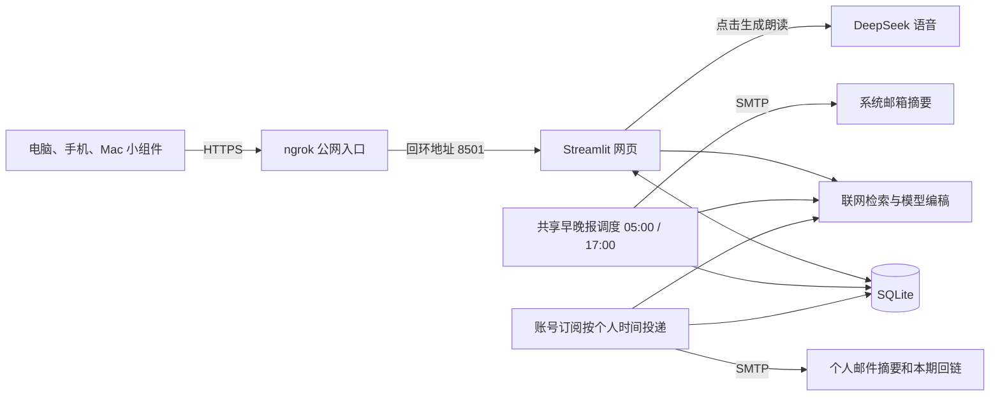

# 通勤日报

每天北京时间 05:00 和 17:00 划分晨晚两期，每期从过去 12 小时内选出 3–6 条能核实发布时间的报道。读者登录后可以浏览自己的日报、打开出处和生成朗读。个人订阅邮件含摘要、出处和本期链接，Mac 小组件显示该账号最近一次成功投递的标题。

## 一、云端怎样运行

AutoDL 上的项目目录是 `/root/autodl-tmp/commute-digest`。现有部署以四个 `screen` 会话运行，SQLite、网页和两个投递进程都在同一台机器上。



网页和小组件共用一个 HTTPS 域名。网页只监听云主机的 `127.0.0.1:8501`。机器主动连接 ngrok、模型和 SMTP 服务。网页和组件均核对登录账号。访客打开首页或旧邮件链接会看到登录入口。登录后，系统按账号查询个人归档。

### 日报和账号怎样关联

| 数据 | 保存内容 |
|---|---|
| 日报 `issues` | 固定的日报编号、生成时间、晨晚时段和中英文报道。网页详情与个人邮件回链使用这个编号。 |
| 账号 `accounts` 和 `account_api_keys` | 用户 ID、密码哈希、邮箱、头像、订阅偏好、投递时间、阅读和界面设置，以及该账号所选的模型和对应密钥。 |
| 个人归档 `account_issues` | 账号、个人期数、日报编号。每位读者从第 1 期开始。两个人看到的“第 1 期”可以指向不同报道。 |

升级时，有旧归属或个人成功投递记录的日报会自动进入对应账号的归档。归属不明的旧期保留在数据库中。系统收件邮箱继续接收定时摘要和原文链接；需要个人网页回链和小组件时，在账号的「订阅设置」启用投递。

### AutoDL 一键启动

在 AutoDL 终端执行，或者先在 Mac 执行 `ssh autodl`，再进入云端项目目录。

```bash
cd /root/autodl-tmp/commute-digest
python3 deploy/一键启动.py
```

在已配置 `autodl` SSH 别名的 Mac 上，服务器同步新版源码后，也可直接运行一条命令。

```bash
ssh -t autodl 'cd /root/autodl-tmp/commute-digest && python3 deploy/一键启动.py'
```

首次运行需有可用的 Python、Bash、GNU screen 和出站网络。向导复用已有 `.env`、`.autodl/ngrok.yml`、SQLite 和同名会话，只询问缺少的参数。首次使用新服务器时准备以下信息。

| 填什么 | 从哪里取得 |
| --- | --- |
| 公网 HTTPS 地址、ngrok Authtoken | ngrok 账号分配的域名和令牌。有现成 ngrok 配置时沿用其中的令牌。 |
| DeepSeek API Key | 共享早晚报联网采集和编稿使用的服务端密钥。 |
| SMTP 主机、端口、账号、授权码 | Gmail 示例为 `smtp.gmail.com`、隐式 TLS 端口 `465`、发件邮箱与应用专用密码。 |
| 共享收件邮箱 | 可以和发件邮箱相同。个人订阅使用各账号在「登录信息」保存的邮箱。 |

命令同步锁定依赖，启动网页、HTTPS 入口和两项调度，检查内网和公网健康接口，成功后打印可访问的网址。新版启动器接管旧 AutoDL 会话时会撤下原 ngrok 统一阅读密码；账号密码仍用于个人资料、私人期次和发布操作。

```bash
python3 deploy/一键启动.py status
python3 deploy/一键启动.py restart
```

`status` 查看服务状态，`restart` 主动重新加载。日志位于 `.autodl/`。断开 SSH 后服务继续运行。AutoDL 关机期间无法投递；重新开机可再次运行同一启动命令。实例如提供开机命令，可将 `cd /root/autodl-tmp/commute-digest && python3 deploy/一键启动.py` 配在该处。

升级前备份 `.env`、`.autodl/ngrok.yml` 和 `COMMUTE_DB` 指定的 SQLite 数据库。旧版另外使用数据库旁的 `.keys/` 后缀目录，例如 `morning.sqlite3.keys/`，升级前一并备份。首次读取账号时，系统会把可读的旧密钥移入同一份 SQLite 数据库，按账号和模型分别保存。数据库提交成功后清理相应旧文件。新版数据库包含可恢复的密钥，在线备份可使用 SQLite 备份命令，并将数据库及备份权限设为仅服务用户可读写。

### 使用 systemd 的 Linux 服务器

模板位于 `deploy/`，默认项目路径为 `/opt/commute-digest`，服务用户为 `commute-digest`。执行 `uv sync --locked`，将 `.env.example` 填好放至 `/etc/commute-digest.env`（`0600`），配置 `COMMUTE_DB=/var/lib/commute-digest/morning.sqlite3` 和实际 `PUBLIC_BASE_URL`。给予服务用户数据库目录的写入权限。使用 [Caddy 模板](../deploy/Caddyfile.example) 反向代理 `127.0.0.1:8501`，配置域名 DNS 与 80/443。已有配置若启用了 Caddy `basic_auth`，升级时相应移除并重载 Caddy。

```bash
sudo install -m 0644 deploy/commute-digest-*.service deploy/commute-digest-send.timer /etc/systemd/system/
sudo systemctl daemon-reload
sudo systemctl enable --now commute-digest-web.service commute-digest-send.timer commute-digest-accounts.service
systemctl list-timers commute-digest-send.timer
```

一台机器选用一套调度方式。AutoDL 启动器使用 screen，普通 Linux 可由 systemd 在开机时拉起服务。

## 二、本地运行

在仓库根目录执行以下命令。打开终端给出的本地地址即可查看网页。SQLite 默认使用 `data/morning.sqlite3`。

```bash
uv sync --locked
uv run python -m streamlit run src/commute_digest/web.py
```

本地发布、朗读或发邮件时，把 `.env.example` 复制为 `.env` 并填写相应配置，再启动所需进程。邮件回链的 `PUBLIC_BASE_URL` 应是收件设备能够访问的网址。

```bash
uv run --env-file .env python -m streamlit run src/commute_digest/web.py
uv run --env-file .env python -m commute_digest.autodl_scheduler
uv run --env-file .env python -m commute_digest.subscription_delivery
```

三个长驻命令分别在独立终端运行。只读网页只需第一条。本地定时投递需要电脑在触发时开机、唤醒且联网。Windows 遇到中文可编辑安装路径导致模块无法导入时，可先在 PowerShell 中运行 `$env:PYTHONPATH = (Resolve-Path .\src).Path`。

## 三、阅读与个人设置

- **读新闻**　列表默认按时间倒序，浅色突出最新一期。右上角可搜索当前阅读语言的新闻标题，按回车确认。时间排序、期数、晨晚报和领域可组合使用。点击「详细浏览」阅读正文和解读，返回列表会保留筛选和页码。「生成朗读」按需合成，点击播放器才开始播放。
- **登录**　首次注册设置显示名和密码，请保存系统分配的 8 位用户 ID。ID 由大写字母和数字组成，可区分重名读者。在同一浏览器登录后，刷新或重新打开网页可在 30 天内恢复登录；选择「退出登录」立即结束本次会话。旧账号首次可用原用户名和密码登录，在「登录信息」查看 ID、设置头像和唯一的订阅邮箱。
- **订阅**　在设置左栏选择「订阅设置」，填写领域、关键词、邮件版式和语言。关注版按所选领域筛选并优先相关关键词；仅填关键词时，报道需要有相应的文字依据。正式发布关注版时，补搜后仍不足 3 条就跳过该期。晨报收件时间可设为北京时间 05:00–16:59，晚报为 17:00–次日 04:59。点击「保存」写入账号，「返回」放弃本页修改。
- **阅读与界面**　拖动「设置」窗口标题可移动位置。侧栏「设置」可切换跨领域版／我的关注、中文／English、日间／夜间，并从五种主题色中选择或输入自定义色值。保存后，侧栏、主要按钮和最新一期的底色随之变化。
- **模型**　选择 DeepSeek Flash、DeepSeek V4 Pro 或通义千问 Plus（百炼北京）。输入框自动载入该账号为所选模型保存的密钥，点眼睛可查看全文。测试按钮默认标明密钥末四位，打开旁边的开关可直接显示整串。点「测试连接」会用当前输入对该模型发起一次简短请求，结果下可查看本次使用的完整密钥。清空后保存即移除该密钥，空密钥无法发起个人调用。通义千问负责编稿，选用它时需另外在一个 DeepSeek 模型下保存自己的密钥，供联网采集和朗读使用。
- **邮件**　每条邮件新闻保留 1–2 句摘要和来源。账号订阅邮件还附个人详情与本期链接，使用收件账号登录后打开。无账号的系统定时邮件只附新闻来源。网页新稿显示详细内容与分析。旧期沿用当时保存的背景与影响，不会重新消耗额度生成。

## 四、Mac 小组件与验收

先升级云端入口，再用 Xcode 打开 [Mac 项目](../macos/CommuteDigest.xcodeproj)，运行 `CommuteDigest`。宿主应用填写 HTTPS 地址、8 位用户 ID 和账号密码，点击「验证并保存」。组件从需要登录的 `/account/widget-feed` 读取该账号最近一次成功订阅投递的标题，点击后用同一账号打开网页。首次个人投递前组件为空。旧版升级后需在宿主应用登录一次。添加组件时搜索「通勤晨报」。

```bash
uv run pytest -q
uv run --env-file .env python -m commute_digest widget-feed
```

第二条用于清理旧版公开组件快照，可重复执行。真实联调时，A 查看四个进程和对应时段日志，B 对照来源核对详情与分析，C 用订阅账号从同一期个人邮件打开网页并对照小组件。现有成功的共享投递按期次去重，个人订阅按账号和期次去重。[课堂汇报框架](通勤晨报项目汇报框架.md)
