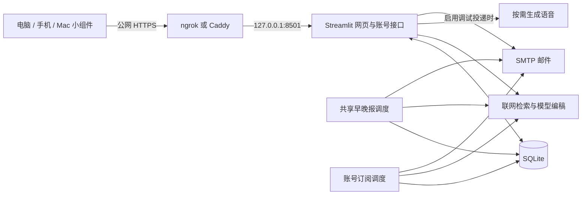

# 通勤日报运行维护

初次使用可从[项目首页](../README.md)选择云端部署、本地运行或 Mac 小组件安装。本文用于现有站点的维护、升级和普通 Linux 部署。

## 服务与数据



- **日报内容。** `issues` 保存固定日报编号、生成时间、期次时段和双语新闻。网页显示详细内容和分析，邮件提取事实摘要、来源和原文链接。旧期保留生成时的文本。
- **账号。** `accounts` 和 `account_api_keys` 保存用户 ID、密码哈希、邮箱、头像、订阅偏好、个人模型密钥和各项设置。应用会读取账号密钥进行模型调用。
- **归档。** `account_issues` 将个人期数和固定日报编号关联。每个账号独立从第 1 期开始。需要原账号才能阅读个人邮件回链和小组件内容。升级时，系统根据旧所有者或成功的个人投递记录补全归属。归属不明的旧期保留在库中。
- **投递。** 共享调度在北京时间 05:00、17:00 处理最近一期。个人订阅按账号选择的两个时间点投递，并分别记录结果。小组件通过带账号认证的 `/account/widget-feed` 读取最近一次个人投递的新闻。

## AutoDL 升级与排查

1. 在项目目录检查 `.env` 中的 `COMMUTE_DB`，未配置时为 `data/morning.sqlite3`。在云主机的私有目录备份 SQLite、`.env` 和实际使用的 ngrok 配置。运行中的 SQLite 可用 `sqlite3 原库路径 ".backup '备份路径'"` 获取一致快照。旧部署如有数据库旁的 `*.keys/` 目录，一并备份。新版本读取账号时会将可读的旧密钥迁入数据库。
2. 同步已测试的源码、`deploy/`、`pyproject.toml`、`uv.lock` 和版本化的主题配置。若服务器目录是 Git 克隆且无本地改动，可在该目录执行 `git pull --ff-only`。保留原有运行配置、ngrok 凭据和数据库文件。
3. 在 AutoDL 项目目录运行 `python3 deploy/一键启动.py`，随后用 `python3 deploy/一键启动.py status` 检查四个服务与内外网。启动器能识别新的代码签名。需要强制重载（如修改环境变量）可执行 `python3 deploy/一键启动.py restart`。实例支持开机命令时，可配置 `cd /root/autodl-tmp/commute-digest && python3 deploy/一键启动.py`。

| 现象 | 核查位置 |
| --- | --- |
| 公网显示 `ERR_NGROK_3200` | 先看 AutoDL 实例是否开机，再运行 `status`。如果本机网页可用而公网不可用，查看 `.autodl/ngrok.log`，核对 ngrok 域名与令牌。 |
| 网页打不开 | 查看 `.autodl/web.log`。在主机执行 `curl -fsS http://127.0.0.1:8501/_stcore/health`，成功时返回 `ok`。 |
| 共享邮件或个人订阅未发出 | 分别查看 `.autodl/daily.log`、`.autodl/accounts.log`，核对北京时间、收件邮箱和 SMTP 配置。个人投递还需读者在网页中保存模型密钥。 |
| 邮件到了但打不开同一期 | 检查 `PUBLIC_BASE_URL` 是否指向生成这期的站点，并在浏览器登录对应的收件账号。系统共享邮件仅提供新闻原文链接。 |

## 普通 Linux 使用 systemd 和 Caddy

有独立公网域名和服务器管理权限时可用本方案。AutoDL 按首页的 screen 方案运行，同一服务器只启用一套调度。

1. 把仓库放在 `/opt/commute-digest`。依模板准备系统用户和同名组 `commute-digest`，让该用户可读取项目和运行项目虚拟环境的解释器。在项目目录执行 `uv sync --locked`。模板会创建权限为 `0700` 的服务数据目录 `/var/lib/commute-digest`。
2. 首次部署时，按配置示例创建 `/etc/commute-digest.env`（权限 `0600`）。指定 `COMMUTE_DB=/var/lib/commute-digest/morning.sqlite3`、实际 `PUBLIC_BASE_URL=https://你的域名`、DeepSeek 和 SMTP 参数。[配置示例](../.env.example)
3. 在 DNS 中把域名指向服务器，允许外部访问 80 和 443。将 Caddy 模板中的域名替换为上一步的实际域名，并将该站点配置加入 Caddy、校验后重载。Caddy 将 HTTPS 请求代理至 `127.0.0.1:8501`，网页和小组件共用这个入口。[Caddy 配置模板](../deploy/Caddyfile.example)
4. 在仓库根目录安装并启动服务。

   ```bash
   sudo install -m 0644 deploy/commute-digest-*.service deploy/commute-digest-send.timer /etc/systemd/system/
   sudo systemctl daemon-reload
   sudo systemctl enable --now commute-digest-web.service commute-digest-send.timer commute-digest-accounts.service
   systemctl list-timers commute-digest-send.timer
   ```

修改 `/etc/commute-digest.env` 后，用 `sudo systemctl restart commute-digest-web.service commute-digest-accounts.service` 重载长驻进程，定时单次任务下次启动会读取新配置。

## 离线检查与课堂演示

在仓库根目录运行 `uv run pytest -q`。需要演示同一期时，A 核对服务器状态，B 在网页打开报道、解读与出处，C 用收件账号从个人邮件或小组件打开这期。个人编号以各自账号为准，三人使用同一个演示账号即可对照。[课堂汇报框架](通勤晨报项目汇报框架.md)
