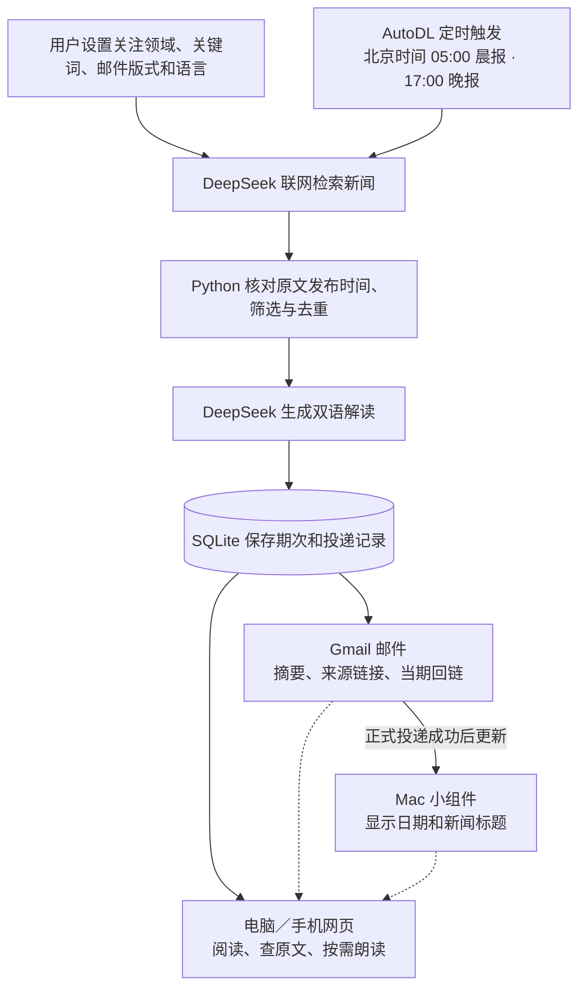

# 通勤晨报｜项目汇报框架

**一句话介绍**

我们做了一个面向学生和上班族的通勤新闻简报。它按关注偏好筛选近期新闻，生成中英文解读，通过网页、邮件和 Mac 小组件供用户阅读。

## 一、整体框架

## 二、各模块做了什么

| 模块 | 实际功能 | 主要技术 |
|---|---|---|
| **新闻筛选** | 每期覆盖对应的 12 小时，从原文能核对发布时间的报道中选 3–6 条。核实不足 3 条时跳过该期。 | Python、DeepSeek 联网工具 |
| **内容编辑** | 覆盖科技与 AI、商业与产业、科学与环境、社会与公共生活。提供跨领域版和「我的关注」版，每条有中英文摘要、背景和影响解读。 | DeepSeek API、SQLite |
| **网页阅读** | 电脑和手机可切换版式与语言、查看原文，按需生成当前语言的朗读。 | Streamlit、DeepSeek TTS |
| **投递与快捷入口** | 云端定时发带原文网址的排版邮件。Mac 大号组件展示最近成功投递一期的日期、晨晚报标签和标题，提供同一期网页入口。 | Gmail SMTP、AutoDL、WidgetKit |

## 三、汇报重点与实测

- **课程契合度**　从订阅偏好输入，到 Python 业务处理、真实模型 API 调用，再到网页和邮件输出，形成完整应用流程。
- **一个设计实例**　联调发现搜索结果曾把仅有日期的报道标为 `00:00`，导致一篇实际在 `06:37` 发布的报道进入 `05:00` 截止的晨报。我们改为读取原页核对具体发布时间。
- **一个实测结果**　11 月 24 日晚报在 `17:00` 自动触发，首轮模型草稿格式异常，重试后 Gmail 收到第 5 期。已核对邮件回链打开同一期，邮件与小组件接口的 5 条标题顺序一致。本地 **72 项 Python 离线测试通过**。

**课堂演示顺序**　打开第 5 期网页 → 切换版式与语言 → 展示一条新闻的原文与朗读 → 用 Gmail 回链打开同一期。
